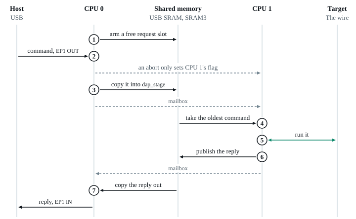

# Architecture

The LPC55S69 has two Cortex-M33 cores. In this firmware CPU 0 talks to the host and CPU 1 talks to
the target. This document says what each core runs, where its code and data live, and the path
each USB interface takes to the code that serves it.

BUSES.md says which bus port each access uses, and why the other core cannot move a wire edge.
STACK.md covers the stacks. HOST-INTERFACE.md is the protocol a host sees, and BOARDS.md the pins.

## The two cores

CPU 1 runs CMSIS-DAP. The commands a host sends, on CMSIS-DAP or on Verge Aux, run there, and so
does the code that drives the wire. Two exceptions stay on CPU 0: `DAP_TransferAbort`, which CPU 0
passes straight to the transfer running, and the four Verge Aux requests that attach a stream to an
energy capture or end it. CPU 1 takes no interrupts. It waits for work by polling a mailbox
register that CPU 0 raises, so nothing on its own core can land in the middle of a transfer.

CPU 0 runs everything that has to answer when something happens: TinyUSB and every endpoint, the
consoles, the DMA interrupt, the LEDs and the energy stream. It never waits on CPU 1 for long: its
only waits are two short spins with a bound, around the energy stream. A CPU 1 that has stopped
answering can still be sent to the bootloader over USB, because CPU 0 answers that request.

| work | core | source |
| --- | --- | --- |
| USB: TinyUSB, the descriptors, every endpoint | CPU 0 | `main.c`, `usb_descriptors.c` |
| Receiving commands and sending replies | CPU 0 | `main.c` |
| `DAP_TransferAbort`: setting CPU 1's abort flag | CPU 0 | `main.c` |
| Running CMSIS-DAP commands, vendor commands included | CPU 1 | `core1_main.c`, `dap_dispatch.c`, ARM's `DAP.c`, `dap_vendor.c` |
| Generating and running the wire code: SWD, JTAG, cJTAG | CPU 1 | `swd_gen.c`, `jtag_gen.c`, `swd_dp.c`, `cjtag_dp.c` |
| Measuring the target's read latency | CPU 1 | `swd_sweep.c`, `jtag_sweep.c` |
| The consoles, VCOM and the Pro's VCOM2 | CPU 0 | `vcom.c` |
| SWO capture: setup and reads | CPU 1 | `swo.c` |
| Energy capture: start, stop, calibration, readings | CPU 1 | `energy_monitor.c` |
| Energy capture while it runs: integrating, stream messages, the range re-arm | CPU 0, and CPU 1 while it owns the capture state (below) | `main.c`, `energy_integration.h`, `energy_stream.c` |
| Verge Aux: the endpoints, sending stream messages, attaching and ending a stream | CPU 0 | `aux.c` |
| DIO pins, SPI and I2C, target supply, target sense | CPU 1 | `dio.c`, `pro_bus.c`, `target_power.c`, `target_sense.c` |
| DIO edges for the energy stream | CPU 0 | `dio_edges.c` |
| The DMA controller: its reset, descriptor table and interrupt | CPU 0 | `main.c` |
| LEDs | CPU 0 | `led.c` |
| Reboot, and entering the bootloader | CPU 0 | `reboot.c` |
| Falling back to full speed | CPU 0 | `usb_speed.c` |
| The core clock and the 96 MHz clock | CPU 0, before CPU 1 starts | `board_clocks.c` |

The two cores run separate images, built and linked on their own. CPU 1 has no FPU, no DSP
extension and no MPU, so its image is compiled for that core. CPU 1's image sits inside CPU 0's,
in flash from `0x4_0000`.

## Starting up

CPU 0 boots first. It sets up the clocks: the core at 150 MHz, and the 96 MHz clock the consoles
run from. It reads the board's straps, which say whether this is a plain MCU-Link or a Pro, which
function jumpers are fitted, and whether the Pro can measure energy. Then it starts the LEDs, sets
the chip's secure controller so that CPU 1 and DMA can reach USB SRAM, and starts the DMA
controller, the consoles and the DIO edge interrupts. Then it starts CPU 1, and last of all USB.

Before CPU 1 starts, CPU 0 gives CPU 1's data bus the top priority on the bus matrix. Where both
cores reach the same memory in the same cycle, CPU 1 goes first, so CPU 0's copies cannot delay a
wire edge (BUSES.md).

CPU 1 copies its data into RAM and clears the rest. It starts the cycle counter, runs ARM's
`DAP_Setup`, and turns the Pro's target supply off. It sets up target sense, energy capture and the
DIO pins. It tells CPU 0 where its `DAP_TransferAbort` flag is, so CPU 0 can set it directly. On a
Pro that can measure energy, it then calibrates, before it takes the first command. Calibration
disconnects J9 for about 0.2 s, and no session is under way yet. It first waits for CPU 0's loop to
hand it the capture state, so CPU 1 cannot finish starting until CPU 0 is running. Then it waits
for commands.

CPU 0 sets up the core clock and the 96 MHz clock, and CPU 1 changes neither. CPU 1 does choose the
clock source of the peripherals it runs: Flexcomm 3 for SWO, the ADC and the timers for energy
capture, and the SPI and I2C bridges.

## Memory

![Where each core's code and data live, and what writes them. Flash holds CPU 0's code from 0x200 and CPU 1's from 0x4_0000. SRAMX holds the generated wire code, which CPU 1 writes at run time. SRAM0 holds CPU 0's data, its stack in the top 4 KiB, its loop and the code a command passes through, the consoles' rings and the energy ring, which DMA fills, and energy capture's state, held by one core at a time. SRAM1 holds CPU 1's 16 KiB of stack, then its data, its command path, the SWD generator and the JTAG scans, and the abort flag CPU 0 sets. SRAM2 holds the rest of CPU 1's data. SRAM3's top 8 KiB, from 0x2003_E000, hold dap_stage: staged commands and replies, the HID replies and Verge Aux's slot, written by both cores. SRAM4 holds the stream messages, 16 slots of 512 bytes, written by the core that holds the capture state. USB SRAM holds TinyUSB's buffers, Verge Aux's included, in its first 4 KiB, written by CPU 0 and the USB controller, and dap_shared from 0x4010_1000: the request and reply slots, queues, DMA's channel table and the SWO ring, written by both cores, the USB controller and DMA.](docs/figures/architecture-memory.svg)

Nothing passes between the images by symbol. Each defines `dap_shared` in a section that both
link scripts place at the same address, and `tools/image.py` checks that both images agree on
every member's offset. `dap_stage` and the stream slots are placed the same way. Two shared objects
are placed by no link script. CPU 1 reaches the energy state in SRAM0 through a pointer CPU 0 puts
in `dap_shared`. CPU 0 reaches CPU 1's abort flag through a pointer CPU 1 puts there.

`dap_shared` is in USB SRAM because the USB controller reaches no other memory, and the command and
reply slots are what it reads and writes. USB SRAM is Device memory to both cores, where an
unaligned access faults. The generated code loads and stores words at any offset: a block write's
data starts at byte 5, and inside `DAP_ExecuteCommands` a reply can start anywhere. So CPU 1 never
runs a command in place. It runs it from a copy in ordinary RAM. By default CPU 0 makes that copy
as the command arrives, into `dap_stage`, and copies the reply back out as it sends it. That is
staging, and vendor command `0x8C` turns it off, after which CPU 1 copies each command and reply
itself.

## USB

### The configuration

One endpoint layout serves both boards. The plain MCU-Link is a Pro with functions left out. A
function the board lacks, or a jumper turns off, is not in the configuration at all.

| function | interface | endpoints | present |
| --- | --- | --- | --- |
| CMSIS-DAP v2 | vendor class, string starting `CMSIS-DAP` | EP1 OUT and IN, bulk | unless the SWD jumper is fitted (J5 plain, J13 Pro) |
| VCOM | CDC ACM, two interfaces | EP2 OUT and IN, bulk; notification `0x86` | unless the VCOM jumper is fitted (J4 plain, J14 Pro) |
| CMSIS-DAP v1 | HID, 64-byte reports | EP3 OUT and IN, interrupt | with CMSIS-DAP v2 |
| VCOM2 | CDC ACM, two interfaces | EP4 OUT and IN, bulk; notification `0x87` | on the Pro |
| Verge Aux | vendor class, string `Verge Aux` | EP5 OUT and IN, bulk | on the Pro, whatever the jumpers |

The interfaces come in this order, and those after a missing one number down. The endpoints keep
their numbers. CMSIS-DAP v2 is interface 0 whenever it is there, and Verge Aux is always last, so
the interfaces stock also has keep stock's numbers. The USB-SIO jumper (J15) changes nothing here:
it turns off the DIO, SPI and I2C bridges, not an interface.

The controller has endpoints 0 to 5. The two notification endpoints are numbers it does not have,
declared the way stock declares them on the Pro, and never opened: the firmware sends no
notification, and the boards wire no modem lines.

Bulk endpoints are 512 bytes at high speed and 64 at full speed. HOST-INTERFACE.md covers the
fall back to full speed and how a host finds each interface.

### Requests on endpoint 0

CPU 0 answers every control request.

- Standard requests and the CDC and HID class requests, through TinyUSB. Setting a console's line
  coding reconfigures its UART. A HID SET_REPORT on endpoint 0 joins the CMSIS-DAP v1 queue, as a
  report on EP3 would.
- Vendor request 2 returns the Microsoft OS 2.0 descriptor.
- Vendor request `0x03` reboots the probe, into the firmware or the ROM bootloader
  (HOST-INTERFACE.md, "Reboot").
- Vendor requests `0x04` and `0x05` are diagnostics: `0x04` reads CPU 1's progress, fault record,
  queues or SWO registers for `tools/dap.py core1`, and `0x05` stops CPU 1 with an NMI that records
  where it was.

## A command's path

A CMSIS-DAP v2 command goes like this:

1. CPU 0 arms EP1 OUT into a free request slot in `dap_shared`. There are three. With none free, it
   leaves the endpoint unarmed, and the controller answers the host's next packet with NAK. A
   command the probe cannot place waits on the host's side; none is dropped.
2. A packet arrives. TinyUSB's task, in CPU 0's loop, hands it to `tud_vendor_rx_cb`. If it is
   `DAP_TransferAbort`, CPU 0 sets CPU 1's abort flag straight away and goes no further: an abort
   has to reach the transfer running now, not wait behind it.
3. Otherwise CPU 0 copies the command into `dap_stage`, gives it the next sequence number and
   publishes its length. It raises CPU 1's mailbox, then arms EP1 OUT into the next free slot.
4. CPU 1 takes the oldest waiting command, by sequence number, from either transport whose reply
   ring has a free slot. It releases the request slot at once, so CPU 0 can receive the next command
   while this one runs. A command numbered before the current USB configuration came from a host
   that has gone, and CPU 1 drops it unrun.
5. CPU 1 runs it. `dap_dispatch.c` sends SWD and JTAG transfers, `DAP_Transfer` and
   `DAP_TransferBlock`, down a short route to the generated code. Everything else goes through
   ARM's `DAP.c`, and vendor ids on to `dap_vendor.c`. The reply goes into `dap_stage`, or, for a
   command CPU 0 did not stage, into CPU 1's own buffer and from there to the reply slot.
6. CPU 1 publishes the reply in the bulk reply ring and raises CPU 0's mailbox.
7. CPU 0 copies a staged reply into the slot's USB buffer and starts the IN transfer. It sends one
   reply at a time, from the head of the ring, so replies leave in the order their commands ran.

`DAP_Info` reports three packets, the number of request slots. probe-rs keeps one of them free for
`DAP_TransferAbort` and pipelines two commands, which is enough to keep the wire busy
(MEASUREMENTS.md, "The command pipeline over USB").

CMSIS-DAP v1 commands take the same path through a queue of their own. Two things differ. CPU 1
runs every HID command's reply in its own buffer, and copies the 64-byte report into the HID reply
ring in `dap_stage`, from which it leaves on EP3 IN. And TinyUSB re-arms the HID endpoint itself,
so a report that finds the queue full has nowhere to wait and is dropped. Only a host with more than
three reports outstanding hits that, since `DAP_Info` told it three.

Each transport has a reply ring of its own because a reply waits on its endpoint until a host reads
it, and a host that has gone never will. With a ring each, such replies hold back only their own
interface (CONCURRENCY.md, "Commands and replies").

Each time the host sets a configuration, which follows every bus reset, CPU 0 starts a new
numbering. CPU 1 drops older commands unrun and CPU 0 drops their replies unsent. CPU 0 also raises
the abort flag, to cut short a command a gone host left running.

## Verge Aux

On the Pro, Verge Aux carries `0x82`, `0x8E`, `0x8F`, `0x90` and `0x94`, so a tool can use the DIO
pins, the supply, energy capture and markers while a debugger holds CMSIS-DAP.

A request takes one slot, in `dap_stage`. CPU 0 copies it in from EP5 OUT and raises CPU 1's
mailbox. CPU 1 answers it before its next CMSIS-DAP command, with the same code that answers that
command on CMSIS-DAP, so a request waits for at most the command running now. CPU 0 sends the reply
on EP5 IN. It arms EP5 OUT again only once the slot is free, so the interface takes one request at
a time. A request from a host that has since gone still runs, since an Aux command needs no session
state; only its reply is dropped.

Four `0x90` modes never reach CPU 1: modes 6, 7, 10 and 13 attach a stream to a running capture or
end it, without touching the capture. CPU 0 answers them itself, because it owns the capture state
while a capture runs (below). When CPU 1 holds the state for a moment, the answer waits. Starting a
capture with a stream, modes 5 and 9, is CPU 1's, like any start.

The energy stream's messages come out of 16 slots in SRAM4. Whichever core owns the capture state
writes them, and CPU 0 sends them on EP5 IN between replies. A capture start's header waits until
the start's reply has gone, so the reply always comes first.

## The consoles

The consoles are CPU 0's. VCOM is Flexcomm 0 on P0_24 and P0_25, on both boards. The Pro's VCOM2 is
Flexcomm 1 on J26. DMA moves every byte. Each console receives into a ring that DMA fills without
stopping, and sends what the host wrote from a buffer of its own, one transfer at a time. CPU 0's
loop moves runs of bytes between TinyUSB and those buffers, so it has no deadline to meet. A
console's line coding comes from the host on endpoint 0, and CPU 0 sets the UART to it.

## The DMA controller

DMA0 is CPU 0's. CPU 0 resets it, points it at its channel table in `dap_shared`, and takes its
interrupt. The consoles use channels 4 to 7. CPU 1 programs only its own two, channel 8 for SWO and
channel 21 for energy capture. CPU 0's interrupt counts their completed segments, and passes their
errors back to CPU 1 through `dap_shared`, along with a lost count for SWO.

## SWO

SWO capture is split between the cores. CPU 1 runs the `DAP_SWO_*` commands. To start a capture
it hands TDO's pin, P0_3, to Flexcomm 3's UART, and points a DMA channel at a ring in USB SRAM. DMA
then fills the ring without stopping, paced only by the UART. CPU 0's DMA interrupt counts each
segment of the ring as it completes. When a host polls with `DAP_SWO_Data`, CPU 1 turns that count
into a position and copies out what has arrived. When capture stops, the pin goes back to the
GPIO for JTAG.

## Energy capture

Energy capture runs on the Pro, with HW_VER_5 fitted, and uses both cores.

- **CPU 1 controls it.** `0x90` starts, stops and reads a capture, from either interface. CPU 1
  calibrates at boot, and again at a start when the last calibration failed or the current range
  jumper changed.
- **The hardware samples it.** A timer, CTimer 2, triggers each conversion of ADC0, which reads the
  target's voltage and current together: a pair. A DMA channel moves the results into a ring in
  SRAM0, in segments of about a millisecond, or longer below about 2,000 pairs a second.
- **CPU 0 integrates it while it runs.** Its DMA interrupt takes each completed segment, adds it
  to the energy total and, while a stream runs, writes the pairs into stream messages. Its loop
  switches the current range back to low when a segment shows the current has fallen, timed
  between samples where the rate leaves room. A capture can hold the high range instead (`0x90`
  mode 14); then nothing switches.
- **One core owns the state at a time.** CPU 1 owns it while no capture runs and for moments
  inside some commands; CPU 0 owns it while a capture runs. CONCURRENCY.md has the handover.
- **A latency measurement holds it.** When CPU 1 measures the target's read latency, it stops the
  conversion timer for the measurement, so the capture's DMA cannot delay a sample on the wire.

The stream's clock is another timer, CTimer 4. Pairs, DIO edges and markers are all stamped on it,
so they share one timeline. DIO edges come from CPU 0's pin interrupts, the only interrupts above
CPU 0's others. A marker (`0x94`) runs on CPU 1, like any command. It goes out with the next pairs
message, or on its own after 10 ms.

## The wire

Every transfer runs on code CPU 1 generates at run time into SRAMX, for the clock, the turnaround,
the idle cycles and the target's read latency in use. The code is placed to the cycle. SWD and JTAG
share one region of SRAMX, and each generates its code again when it finds the other's there.

CPU 1 generates the code again whenever a setting it depends on changes: as the command that
changes it runs, or at the start of the next transfer command. Either way the wire waits while the
code is generated. CODEGEN.md lists what triggers it.

ARM's command logic stays in C around the generated code: posted reads, WAIT retries, value
matching and timestamps. The sequence commands `DAP_SWJ_Sequence` and `DAP_SWD_Sequence` still run
ARM's C, and so do the OScan2 and OScan6 frames `0x83` sends to switch a target's format
(`cJTAG_FrameTap`). `DAP_JTAG_Sequence` runs on the generated scans.

A connection measures the target's read latency on the wire before it trusts a sample position:
at a fast clock, when its first read fails, and on a Pro when a capture changes which latencies the
code serves. It measures only while the latency is automatic; `0x89` and `0x8A` can pin one, and
report the generated code.

TIMING.md has the timing rules the code is placed by, CODEGEN.md the generators, and CJTAG.md the
cJTAG wire.

## LEDs

CPU 0 drives the LEDs from one timer interrupt, CTimer 3's, 488 times a second. CTimer 3 also fades
the status LED. On the Pro, CTimer 1 fades the FUNC LED, and the other LEDs are on GPIO port 1. CPU
1's part is a byte store for each thing it reports, which the next tick reads (`led.h`). BOARDS.md
says what each LED means.

## Reboot

Vendor request `0x03` reaches CPU 0 on endpoint 0. CPU 0 leaves the bus, waits at least 20 ms, and
resets the chip. For the bootloader it first writes the boot mode into an always-on register that
the ROM reads at reset. The ROM's own call for this does not work on this part (erratum ISP.1).

## When CPU 1 faults

CPU 1 takes no interrupts, so any exception it takes is a fault. It records its fault registers and
where it was in `dap_shared`, then stops. CPU 0 keeps running and reports the record through vendor
request `0x04`, which `tools/dap.py core1` reads. Each core has a stack limit, so an overflow faults
rather than overwriting the memory below (STACK.md).
